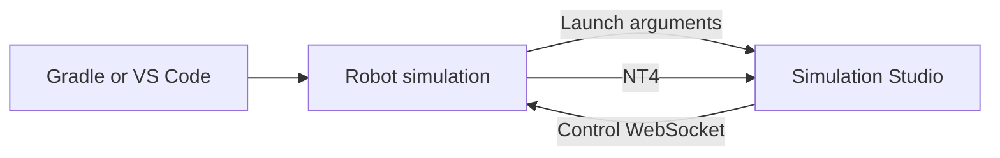

# Simulation Studio

A native desktop Driver Station and NetworkTables workspace for local FRC robot simulation. Built with Tauri, React, and Rust; no bundled Chromium or Node runtime.

## Install

Download the installer for your platform from [Releases](https://github.com/simonstoryparker/simulation-studio/releases/latest):

- **macOS:** open the `.dmg` for Apple Silicon or Intel and drag **Simulation Studio** into **Applications**. When upgrading manually, close Studio and choose **Replace** for the existing app.
- **Windows x64:** run the `-setup.exe`. It installs for the current user, creates shortcuts, and upgrades an existing installation. Setup installs WebView2 if needed.

Close Studio before running a downloaded installer. There is no uninstall step for an upgrade. Node and Rust are only needed to develop the app.

Like [Dashshund](https://github.com/jonahsnider/dashshund), these downloads do not have Apple Developer ID/notarization or Windows Authenticode signing. Your OS may require first-launch approval. Automatic updates still require cryptographic signatures. Downloads become available after the first release completes [release setup and platform validation](docs/releases.md).

## Updates

Studio checks on startup and every six hours while open, downloads updates automatically, and offers **Settings → App updates → Restart to update**. Stop the simulation first; updates never restart Studio while a control or NT connection is active. Your workspaces and controller profiles survive replacement. Every restart begins disabled with no held inputs or running match.

Downloads use public GitHub Releases and verified updater signatures. No login is needed. macOS may request administrator authorization to replace an app in `/Applications`. Failed downloads leave the installed app usable. If replacement fails, choose **Download installer** and run it after closing Studio.

## Robot integration

The robot project launches Studio with:

```sh
simulation-studio --control ws://127.0.0.1:5811 --nt ws://127.0.0.1:5810/nt/simulation-studio --project robot
```

On macOS, launch the bundle through Launch Services:

```sh
open -n -a "/Applications/Simulation Studio.app" --args --project robot
```

Only loopback simulation endpoints are accepted. A second launch forwards arguments to the existing window. One app controls one simulation at a time; avoid simultaneous simulations on the default ports. See [the public protocol contract](docs/protocol.md) to integrate another robot project. This application does not bundle robot code, WPILib, CAD, or robot models.



## Use

- Enable/Disable, Auto, Teleop, Test, Full Match, alliance, state, elapsed time, and E-stop are in the left control column. Select Full Match, edit its 20 second Auto, 3 second disabled transition, and 140 second Teleop durations, then press Enable to start. Mode/alliance changes cancel a running sequence. E-stop stays latched until the simulation restarts. Losing focus in the main window disables simulation and automatically switches to compact mode; subsequent focus loss in compact mode keeps simulation enabled and clears keyboard keys. The robot watchdog still disables after 250 ms without valid frames.
- **Controllers** is a permanent tab. Assign physical gamepads independently from the active keyboard port. The keyboard can contribute to the same port as a physical gamepad; buttons merge, and held keyboard axis/D-pad directions take priority. Switching keyboard ports clears held keys without interrupting the gamepad. Click a controller control to capture its next key; Escape cancels, and Clear removes a binding. Port reassignment and unplugging disable simulation. Device assignments are never silently replaced.
- Click/drag any NT entry to add a widget. Open a folder and choose **Open all entries in folder** to create independent widgets recursively. Choosers are grouped; duplicates are skipped. Run it again to add newly published entries. No folder has special feature-flag or tuning behavior.
- Move/resize widgets and organize them in named tabs. Double-click a tab to rename it; each tab has a close button, and at least one workspace tab remains. Supported editable widgets, including choosers and tunables, publish immediately by default. Readout and details widgets stay display-only. A slider requires an explicit range; a custom selector requires explicit typed options.
- Click away from Studio to automatically turn the same app window into an always-on-top overlay, or use **Settings → Open compact overlay**. Use the overlay’s expand button to restore the full window. It starts at 320 × 180 logical pixels, can be resized and moved, and remembers its bounds per workspace. Enable/Disable, mode selection, current state/time, and keyboard port switching are available by default; alliance and E-stop are optional overlay controls. Choose overlay controls and select and order workspace topics in **Settings**, which also contains the project and connection endpoints. Compact mode requires window focus for keyboard input but keeps simulation and physical controllers active when focus moves elsewhere.
- NT integers use decimal strings throughout IPC to preserve signed 64-bit precision. Integer array editors require quoted JSON values, e.g. `["9007199254740993"]`. Raw/structured formats are read-only; value previews have a shared 4 KiB budget and at most 100 array elements. Full cached details are fetched only on request.
- Standard `SendableChooser` widgets display `options`, publish `selected` (including when the robot has not published that setter topic), and display robot-reported `active` separately. The app discovers `.type` metadata at any path.
- NT does not promise robot acknowledgement of a write. Widgets distinguish locally published values from received values; robot publication can overwrite the local edit. Disconnected writes are rejected and never replayed.
- Layouts, input profiles, keyboard destination, match durations, Topics visibility, and compact overlay settings save per project in the operating system's application-data directory for `org.team581.simulation-studio`. Version 1 workspaces migrate on load. Values, enable state, held keys, and a running match are never restored from a workspace.

## Add a widget type

Add a definition to `src/widgets.tsx`'s registry and its identifier to `WidgetKind`. Each definition supplies compatibility, default settings, a settings component, and a renderer. Renderers use the shared `useTopic`, `useDescriptor`, and `useSubscriptions` hooks and the typed `write_topic` command. Keep network connections out of widgets; one shared subscription serves every consumer of a topic. Add workspace validation/migration support when changing persisted configuration. Runtime third-party plugins are outside v1.

## Develop and test

Install Node 22 LTS or newer, stable Rust, and [Tauri platform prerequisites](https://tauri.app/start/prerequisites/). macOS needs Xcode Command Line Tools; Windows needs MSVC Build Tools and WebView2; Linux development needs WebKitGTK 4.1 and libudev development packages.

```sh
npm ci
npm run desktop
npm run check
npm run package
```

`npm run check` runs the production frontend build, frontend/UI tests, release-manifest tests, Clippy, and native Rust tests. All run from this repo without any private robot checkout. `cargo test --manifest-path src-tauri/Cargo.toml protocol` includes a real local WebSocket fixture. The native telemetry tests exercise large NT catalogs and typed values. Native UI and physical-device checks remain platform acceptance tasks.

`npm run package` makes a local development app; distribution with signed updates uses the release workflow. Development builds without a configured updater key disable automatic updates.

See [release setup and acceptance checks](docs/releases.md), [test ownership](docs/test-ownership.md), [source provenance](SOURCE.md), and [performance validation](PERFORMANCE.md). No general reuse license is granted; dependency licenses remain applicable.
