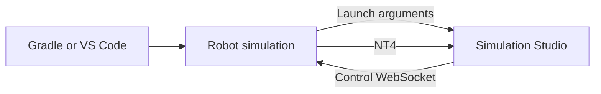

# Development

Install Node 22 or newer, stable Rust, and the [Tauri platform prerequisites](https://tauri.app/start/prerequisites/). macOS needs Xcode Command Line Tools; Windows needs MSVC Build Tools and WebView2. Linux development needs WebKitGTK 4.1 and libudev development packages; the complete CI package list is in [the check workflow](../.github/workflows/check.yml).

```sh
npm ci
npm run desktop
```

## Checks and packaging

`npm run check` runs the production frontend build, frontend/UI tests, release-manifest tests, Clippy, and Rust tests. These checks do not need the robot repository. `cargo test --manifest-path src-tauri/Cargo.toml protocol` includes a local WebSocket fixture; native telemetry tests cover large NT catalogs and typed values.

`npm run package` builds a local app bundle on macOS or an executable on Windows/Linux. Distribution installers and signed updates use the [release workflow](releases.md). Development builds without an updater key disable automatic updates.

See [test ownership](test-ownership.md) for the split between app and robot tests, and [performance validation](../PERFORMANCE.md) for measurements and outstanding checks. Native UI and physical controller checks still need platform testing.

## Robot integration

The robot project launches Studio with:

```sh
simulation-studio --control ws://127.0.0.1:5811 --nt ws://127.0.0.1:5810/nt/simulation-studio --project robot
```

On macOS, launch the bundle through Launch Services:

```sh
open -n -a "/Applications/Simulation Studio.app" --args --project robot
```

Only loopback simulation endpoints are accepted. A second launch forwards arguments to the existing window. One app controls one simulation at a time; avoid simultaneous simulations on the default ports. See [the protocol](protocol.md) to integrate another robot project. This application does not bundle robot code, WPILib, CAD, or robot models.



## Add a widget type

Add a definition to the registry in [`src/widgets.tsx`](../src/widgets.tsx) and its identifier to `WidgetKind`. Each definition supplies compatibility, default settings, a settings component, and a renderer.

Renderers use the shared `useTopic`, `useDescriptor`, and `useSubscriptions` hooks and the typed `write_topic` command. Keep network connections out of widgets; one shared subscription serves every consumer of a topic. Add workspace validation and migration support when changing persisted configuration. Runtime third-party plugins are not supported.

